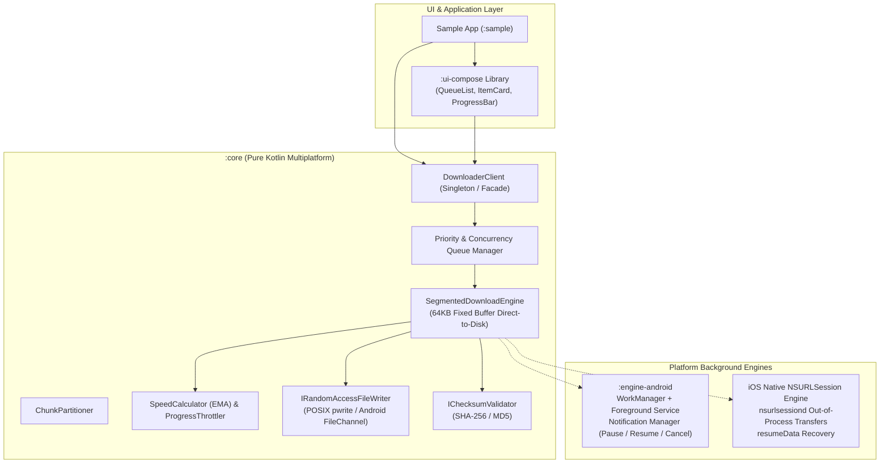

# CMP File Downloader SDK

A production-grade, highly resilient **Compose Multiplatform (CMP) / Kotlin Multiplatform (KMP)** File Downloader SDK for **Android** and **iOS**. 

Engineered for enterprise reliability, high-throughput segmented parallel streaming, robust pause/resume recovery, native background survivability, and ultra-efficient zero-OOM memory and disk management for multi-gigabyte files (>2GB and >10GB).

---

## Table of Contents
- [Why CMP File Downloader?](#why-cmp-file-downloader)
- [Key Features & Capabilities](#key-features--capabilities)
- [Architectural Overview](#architectural-overview)
- [Module Structure](#module-structure)
- [Installation](#installation)
- [Platform Setup](#platform-setup)
  - [Android Setup](#android-setup)
  - [iOS Setup](#ios-setup)
- [Quick Start Guide](#quick-start-guide)
  - [1. Initialize the Downloader](#1-initialize-the-downloader)
  - [2. Enqueue a Download](#2-enqueue-a-download)
  - [3. Observe Download Progress & State](#3-observe-download-progress--state)
  - [4. Control Downloads (Pause, Resume, Cancel, Delete)](#4-control-downloads-pause-resume-cancel-delete)
  - [5. Drop-in Compose Multiplatform UI](#5-drop-in-compose-multiplatform-ui)
- [Advanced Configuration](#advanced-configuration)
  - [File Collision Strategies](#file-collision-strategies)
  - [Integrity Checksums (SHA-256 / MD5)](#integrity-checksums-sha-256--md5)
  - [Disk Space Pre-flight Verification](#disk-space-pre-flight-verification)
  - [Exponential Backoff Retry Policy](#exponential-backoff-retry-policy)
- [Verification & Testing](#verification--testing)
- [License](#license)

---

## Why CMP File Downloader?

Developing a file downloader across Android and iOS often forces a tradeoff: either write two separate native SDKs (doubling development and bug-fixing costs) or use a pure cross-platform HTTP client (like Ktor Darwin), which **fails** when the app is suspended or killed on iOS.

**CMP File Downloader adopts the best of both worlds:**
1. **Shared KMP Core:** A single, tested codebase for request queues, priority scheduling, concurrency pools, state machines, exponential backoff retries, disk integrity verification, and EMA speed smoothing.
2. **Platform-Native Background Engines:**
   - **Android:** Integrates directly with `WorkManager` and promotes active downloads to a `Foreground Service` with ongoing notifications and interactive Pause/Resume/Cancel intents.
   - **iOS:** Integrates directly with Apple's out-of-process `NSURLSession` background configuration daemon (`nsurlsessiond`), allowing downloads to proceed uninterrupted even if the app is suspended, terminated, or the device restarts.
3. **Zero-OOM Constant Memory Footprint:** Streams network bytes directly to disk via small, fixed 64KB buffers using random-access file writers (`FileChannel` on Android, POSIX `pwrite` on iOS). Even 10GB+ files consume less than 1MB of heap.
4. **Drop-in Compose Multiplatform UI:** Pre-built, reactive Material 3 components that work identically on Android and iOS with zero heavy icon dependencies.

---

## Key Features & Capabilities

- 🚀 **Multi-Segment Parallel Streaming:** Intelligently partitions files into parallel chunks using HTTP `Range: bytes=start-end` requests, maximizing throughput on high-speed connections.
- 🔁 **Automatic Fallback:** Dynamically falls back to single-stream download if the remote server returns `200 OK` without range support.
- 💾 **Large File (> 2GB & > 10GB) Safe:** Built end-to-end with 64-bit signed offsets (`Long`), pre-flight disk space safety margin checks, and atomic staging (`.tmp` -> final destination).
- ⏸️ **Resilient Pause & Resume:** Resume downloads right where they left off using HTTP byte ranges on Android and native `resumeData` on iOS.
- 📱 **True Background Survivability:**
  - Survives app backgrounding, process death, and low-memory kills.
  - Interactive notifications with real-time progress bars, speed, ETA, and notification actions on Android.
  - Native `AppDelegate` background URL session reconnection on iOS.
- 📊 **Smoothed Speed & ETA Calculator:** Exponential Moving Average (EMA) filter with a 150ms debouncer prevents UI stutter while providing accurate transfer rates.
- 🔒 **End-to-End Integrity Validation:** Automatically verifies downloaded files against SHA-256 or MD5 checksums upon completion.
- 🎯 **Priority & Concurrency Management:** Configure maximum concurrent downloads; higher-priority items preempt or queue ahead of lower-priority tasks.
- 🎨 **Ready-to-Use UI Library:** Clean, modern Compose Multiplatform components (`DownloadQueueList`, `DownloadItemCard`, `DownloadProgressBar`, `DownloadStatusBadge`).

---

## Architectural Overview



---

## Module Structure

The project is structured into modular, decoupled Gradle modules:

| Module | Target | Responsibility |
| :--- | :--- | :--- |
| **`:core`** | KMP (Android & iOS) | Domain models, `DownloaderClient` API, priority queue, random-access file writers, segmented downloader, checksum validators, and iOS native `NSURLSession` engine. |
| **`:engine-android`** | Android Library | Android `WorkManager` worker, Foreground Service, persistent Notification Manager, and broadcast action receiver. |
| **`:ui-compose`** | CMP (Android & iOS) | Reusable Compose Multiplatform widgets, self-contained vector icons, reactive state bindings. |
| **`:sample`** | Application | Demo application showcasing single downloads, parallel 4-segment downloads, and multi-file batch tests. |

---

## Installation

Add the desired modules to your multiplatform project dependencies (`build.gradle.kts`):

```kotlin
// For common KMP/CMP source sets:
commonMain.dependencies {
    implementation("io.github.cmp.downloader:core:<version>")
    
    // Optional: Add pre-built Compose Multiplatform UI components
    implementation("io.github.cmp.downloader:ui-compose:<version>")
}

// For Android-specific source sets (to enable WorkManager & Foreground Services):
androidMain.dependencies {
    implementation("io.github.cmp.downloader:engine-android:<version>")
}
```

---

## Platform Setup

### Android Setup

1. **Permissions (`AndroidManifest.xml`):**
Ensure your app requests the necessary network and service permissions:

```xml
<manifest xmlns:android="http://schemas.android.com/apk/res/android">
    <uses-permission android:name="android.permission.INTERNET" />
    <uses-permission android:name="android.permission.ACCESS_NETWORK_STATE" />
    <uses-permission android:name="android.permission.POST_NOTIFICATIONS" />
    <uses-permission android:name="android.permission.FOREGROUND_SERVICE" />
    <uses-permission android:name="android.permission.FOREGROUND_SERVICE_DATA_SYNC" />
</manifest>
```

2. **One-Line Android Initialization (`MainActivity.kt` or `Application.kt`):**

```kotlin
import io.github.cmp.downloader.android.CmpDownloader

class MyApplication : Application() {
    override fun onCreate() {
        super.onCreate()
        
        CmpDownloader.initialize(this) {
            maxConcurrentDownloads(3)
            maxSegmentsPerFile(4)
        }
    }
}
```

---

### iOS Setup

1. **Enable Background Modes (`Info.plist`):**
Add `Background fetch` and `Background processing` under `UIBackgroundModes`:

```xml
<key>UIBackgroundModes</key>
<array>
    <string>fetch</string>
    <string>processing</string>
</array>
```

2. **iOS Engine Initialization (`MainViewController.kt` or `AppDelegate.swift`):**

In Kotlin Multiplatform:
```kotlin
import io.github.cmp.downloader.ios.CmpDownloaderIos

fun MainViewController(): UIViewController {
    val client = CmpDownloaderIos.initialize(sessionIdentifier = "com.myapp.downloader") {
        maxConcurrentDownloads(3)
        maxSegmentsPerFile(4)
    }
    return ComposeUIViewController {
        App(downloaderClient = client)
    }
}
```

In Swift (`AppDelegate.swift`):
```swift
import UIKit
import SampleComposeApp // or CmpDownloaderCore

@main
class AppDelegate: UIResponder, UIApplicationDelegate {

    func application(
        _ application: UIApplication,
        handleEventsForBackgroundURLSession identifier: String,
        completionHandler: @escaping () -> Void
    ) {
        // Bridge the iOS completion handler back to the downloader engine
        CmpDownloaderIos.shared.handleEventsForBackgroundURLSession(
            sessionIdentifier: identifier,
            completionHandler: completionHandler
        )
    }
}
```

---

## Quick Start Guide

### 1. Initialize the Downloader

Initialize with custom configuration presets:

```kotlin
val client = DownloaderClient.initialize {
    maxConcurrentDownloads(4)       // Up to 4 files downloading in parallel
    maxSegmentsPerFile(4)           // Partition files into up to 4 parallel segments
    bufferSizeBytes(64 * 1024)      // 64 KB fixed streaming buffer
    defaultDirectory("/path/to/downloads")
    retryPolicy(
        RetryPolicy(
            maxRetries = 3,
            initialBackoffMs = 1000L,
            backoffMultiplier = 2.0
        )
    )
}
```

### 2. Enqueue a Download

Build a type-safe `DownloadRequest` using the fluent builder:

```kotlin
import io.github.cmp.downloader.core.model.*

val request = DownloadRequest.Builder(
    url = "https://example.com/large-archive.zip",
    destinationDirectory = "/path/to/downloads"
)
    .fileName("large-archive.zip")
    .priority(Priority.HIGH)                         // CRITICAL, HIGH, NORMAL, LOW
    .maxSegments(4)                                  // Multi-segment parallel streaming
    .collisionStrategy(CollisionStrategy.AUTO_RENAME)// AUTO_RENAME, OVERWRITE, FAIL_IF_EXISTS
    .checksum(
        expected = "5d41402abc4b2a76b9719d911017c592",
        algorithm = ChecksumAlgorithm.MD5
    )
    .tag("Backup Archive")
    .addHeader("Authorization", "Bearer token_abc123")
    .build()

val taskId = client.enqueue(request)
```

### 3. Observe Download Progress & State

Observe individual tasks or the entire download queue using Kotlin `Flow`:

```kotlin
// Observe a single download
coroutineScope.launch {
    client.observeProgress(taskId).collect { progress ->
        println("Progress: ${progress.progressPercentage}%")
        println("Speed: ${progress.formattedSpeed}")
        println("ETA: ${progress.formattedEta}")
        println("Downloaded: ${progress.formattedDownloadedBytes} / ${progress.formattedTotalBytes}")
    }
}

// Observe all tasks in the queue
coroutineScope.launch {
    client.observeAllTasks().collect { tasks ->
        println("Total tasks: ${tasks.size}, Running: ${tasks.count { it.status == DownloadStatus.RUNNING }}")
    }
}
```

### 4. Control Downloads (Pause, Resume, Cancel, Delete)

All actions are thread-safe and non-blocking:

```kotlin
// Pause an active download
client.pause(taskId)

// Resume a paused or failed download
client.resume(taskId)

// Cancel an ongoing download
client.cancel(taskId)

// Cancel and delete temporary/downloaded files from disk
client.delete(taskId)
```

### 5. Drop-in Compose Multiplatform UI

Easily add production-ready download UI to your Compose Multiplatform screens:

```kotlin
import androidx.compose.runtime.Composable
import androidx.compose.runtime.rememberCoroutineScope
import io.github.cmp.downloader.core.client.DownloaderClient
import io.github.cmp.downloader.ui.DownloadQueueList

@Composable
fun DownloadCenterScreen(downloaderClient: DownloaderClient = DownloaderClient.getInstance()) {
    val coroutineScope = rememberCoroutineScope()

    DownloadQueueList(
        downloaderClient = downloaderClient,
        coroutineScope = coroutineScope,
        modifier = Modifier.fillMaxSize()
    )
}
```

Or assemble custom interfaces with individual widgets:
- `DownloadItemCard(task, progress, onPause, onResume, onCancel, onDelete)`
- `DownloadProgressBar(progress)`
- `DownloadStatusBadge(status)`
- `DownloadActionButtons(status, onPause, onResume, onCancel, onDelete)`

---

## Advanced Configuration

### File Collision Strategies
Control behavior when a file with the same name already exists in the destination folder:

```kotlin
DownloadRequest.Builder(url, destination)
    // Automatically appends (1), (2), etc.
    .collisionStrategy(CollisionStrategy.AUTO_RENAME)
    
    // Replaces existing file
    .collisionStrategy(CollisionStrategy.OVERWRITE)
    
    // Fails the task with FileAlreadyExistsException
    .collisionStrategy(CollisionStrategy.FAIL_IF_EXISTS)
    .build()
```

### Integrity Checksums (SHA-256 / MD5)
Protect against corrupted or tampered downloads. Uses platform-native hardware acceleration (`MessageDigest` on Android, Apple `CommonCrypto` on iOS):

```kotlin
DownloadRequest.Builder(url, destination)
    .checksum(
        expected = "e3b0c44298fc1c149afbf4c8996fb92427ae41e4649b934ca495991b7852b855",
        algorithm = ChecksumAlgorithm.SHA256
    )
    .build()
```

### Disk Space Pre-flight Verification
Before connecting to the network, the engine queries the target filesystem (`StatFs` on Android, `NSURLVolumeAvailableCapacityKey` on iOS). If remaining space is less than the file size plus a safety margin (50MB), the download immediately terminates with `InsufficientStorageException` before wasting battery and network bandwidth.

### Exponential Backoff Retry Policy
Network dropouts and transient HTTP errors (500, 502, 503, 504) automatically trigger exponential backoff with jitter:

```kotlin
val customPolicy = RetryPolicy(
    maxRetries = 5,
    initialBackoffMs = 1500L,
    backoffMultiplier = 2.0,
    maxBackoffMs = 60000L
)
```

---

## Verification & Testing

The SDK has been verified across test suites and compilation targets:

```bash
# Run all unit tests across Android JVM and iOS Simulator Arm64:
./gradlew check

# Build all libraries (AARs and iOS Klibs):
./gradlew :core:assemble :engine-android:assemble :ui-compose:assemble

# Build Android Debug & Release Sample APKs:
./gradlew :sample:assembleDebug :sample:assembleRelease

# Link Apple Silicon iOS Frameworks (Debug & Release):
./gradlew :sample:linkDebugFrameworkIosSimulatorArm64
./gradlew :sample:linkReleaseFrameworkIosArm64

# Full end-to-end multiplatform build:
./gradlew assemble
```

---

## License

```text
Copyright 2026 CMP File Downloader Contributors

Licensed under the Apache License, Version 2.0 (the "License");
you may not use this file except in compliance with the License.
You may obtain a copy of the License at

    http://www.apache.org/licenses/LICENSE-2.0

Unless required by applicable law or agreed to in writing, software
distributed under the License is distributed on an "AS IS" BASIS,
WITHOUT WARRANTIES OR CONDITIONS OF ANY KIND, either express or implied.
See the License for the specific language governing permissions and
limitations under the License.
```